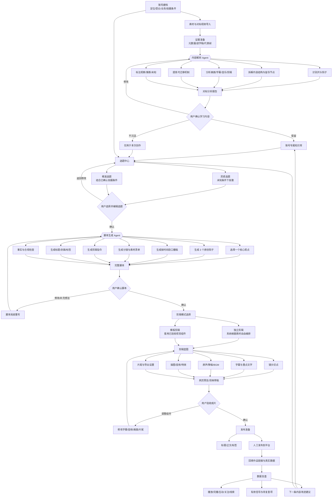
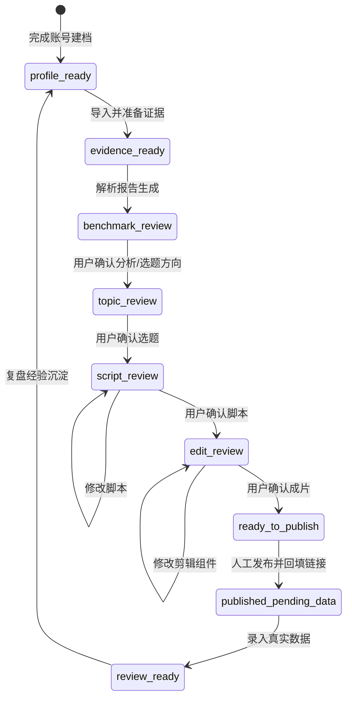

# 短视频 AI 脚本生成与复盘工作台 MVP

## 双 Agent 工作流画布

## 状态流转

## 节点职责简表

| 区域 | 核心职责 | 关键产物 |
|---|---|---|
| 账号建档 | 建立真实业务和拍摄边界 | 账号档案 |
| 内容解析 Agent | 从证据中提炼机制，不写最终脚本 | 分析报告、学习候选 |
| 账号知识库 | 保存已确认且适合该账号的经验 | 专属知识条目 |
| 选题中心 | 在灵感和精准两条线路上产出方向 | 3 个候选选题 |
| 脚本生成 Agent | 把确认后的方向改造成原创可拍脚本 | 正式脚本 |
| 剪辑模块 | 将脚本映射到素材、字幕和音频 | 剪辑蓝图、成片 |
| 发布准备 | 整理人工发布所需信息 | 发布包 |
| 数据复盘 | 用真实数据形成下一轮改进 | 复盘报告、优化建议 |

## 关键设计原则

1. **先证据，后生成**：没有证据的内容必须标记未知或待确认。
2. **解析与创作分离**：分析 Agent 不直接替代脚本 Agent。
3. **每阶段可独立使用**：用户可以单独做对标分析、脚本生成或剪辑。
4. **确认后再流转**：脚本、成片和知识沉淀都保留人工确认点。
5. **局部修改优先**：调整单个组件时不破坏已确认的其他组件。
6. **数据反哺但不夸大**：样本不足时只建立基线，不直接预测爆款。
