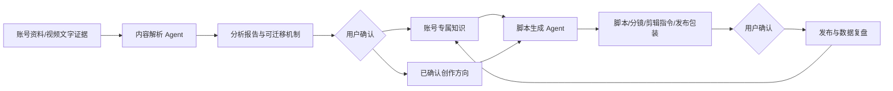

# 短视频 AI 脚本生成与复盘工作台 MVP

一个面向本地商家和个人 IP 的 AI 内容生产工作流作品集。

> 本仓库是公开展示版，只包含脱敏后的产品设计、Agent 架构、提示词、变量定义和测试 Demo，不包含客户资料、真实素材、API Key、服务器信息或核心业务代码。

## 项目解决什么问题

把对标视频分析、选题、脚本、剪辑准备、发布准备和数据复盘串成一个可确认、可修改、可复用的工作流，降低小团队持续产出内容的门槛。

## 双 Agent 架构

## 目录

- [项目设计](docs/project-design.md)
- [工作流画布](docs/workflow-canvas.md)
- [提示词与变量](docs/prompts-and-variables.md)
- [可演示 Demo](docs/demo.md)
- [测试与边界](docs/evaluation.md)

## Demo 使用方式

本仓库不依赖密钥即可理解和演示设计：

1. 打开 `docs/demo.md`。
2. 使用示例输入运行内容解析 Agent。
3. 检查结构化输出中的证据、未知项和可迁移机制。
4. 将用户确认后的结果交给脚本生成 Agent。
5. 对照预期输出检查脚本、分镜、剪辑指令和事实边界。

## 我的工作

- 设计双 Agent 职责边界和中间数据结构。
- 将自然语言需求拆解为可确认的工作流节点。
- 设计提示词中的证据纪律、事实边界和失败处理。
- 建立正常输入、边界输入和幻觉输出测试案例。
- 完成本地原型到云端内部测试版的部署验证。

## 重要边界

模型可以帮助整理证据、提炼结构和生成候选脚本，但不能保证爆款、不能替代事实核验，也不能在素材缺失时凭空补齐真实业务信息。
